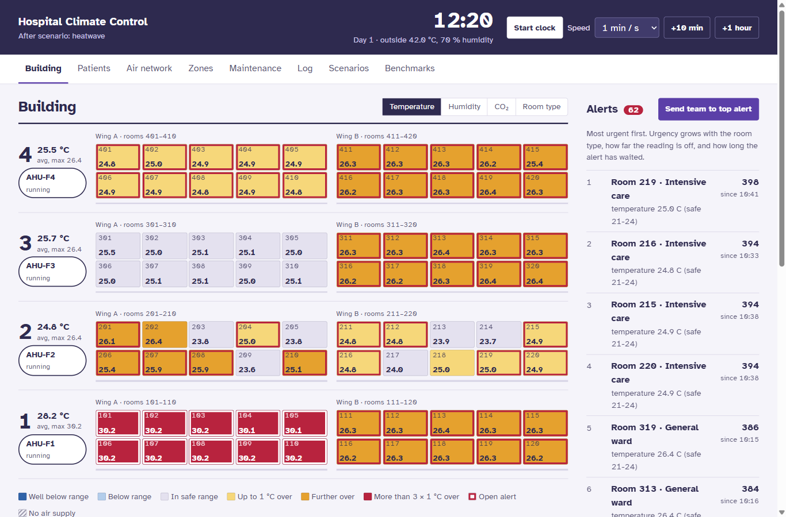
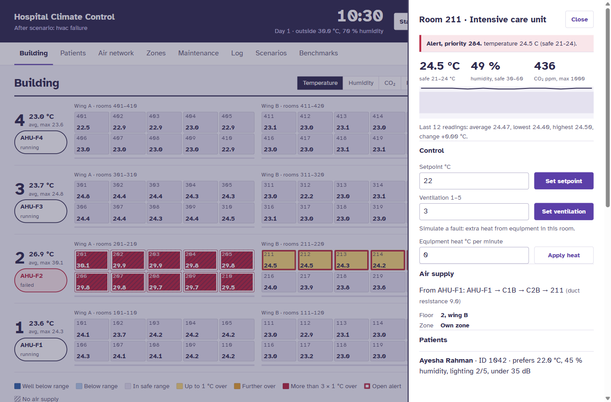
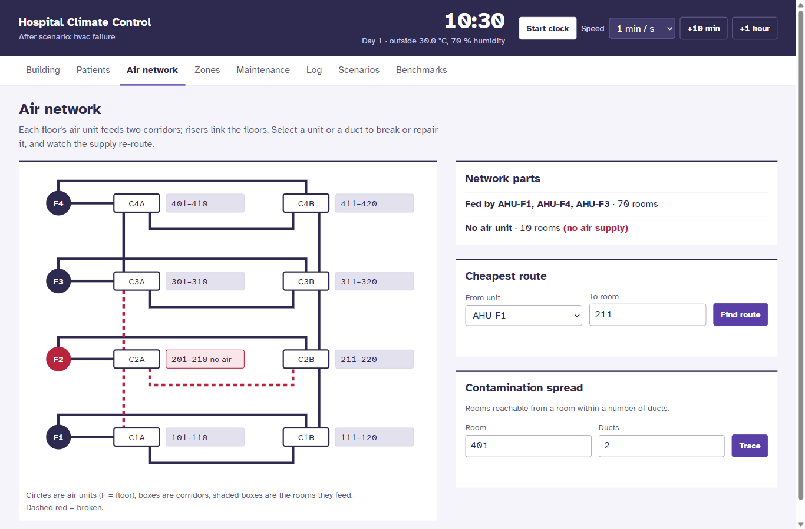

<<<<<<< HEAD
# SMART-HOSPITAL-AUTOMOTIVE-CLIMATE-CONTROL
=======
# Smart Hospital Automated Climate & Patient Comfort Control System

A web-based simulation of a hospital climate controller, built to show how the
right data structure solves each sub-problem: buffering a stream of sensor
readings, serving the most critical room first, finding rooms and patients
instantly, spotting rapid temperature rises, and handling faults through the
building's duct network.

**Live site:** <https://sumon-pro-arc.github.io/SMART-HOSPITAL-CLIMATE-CONTROL/>
(runs entirely in your browser; nothing to install).



All 13 data structures and algorithms in the project proposal are written
from scratch in [`hospital_climate/ds/`](hospital_climate/ds). A test fails the
build if any of them uses Python's ready-made ones (`heapq`, `dict`, `set`,
`sorted`, `collections`, ...).

* **Web dashboard:** a live floor plan of the hospital, the alert queue,
  patients, the air-duct network, zones, maintenance, the event log, the
  scenarios and the benchmark charts, all in the browser.
* **Language:** Python 3, standard library only, for both the simulation and
  the web server. The pages are plain HTML, CSS and JavaScript. Nothing to install.
* **Tests:** 69 unit, scenario, web-API, live-site and benchmark-harness tests,
  run by GitHub Actions on every push.
* **Benchmarks:** each structure timed against the naive approach, with
  charts, in [`docs/benchmarks/results.md`](docs/benchmarks/results.md).
* **Design and complexity analysis:** [`docs/design.md`](docs/design.md).

> This is a teaching simulation. The safe temperature and humidity ranges are
> simulation defaults, not clinical guidance (see
> [design.md §4](docs/design.md#4-simulation-model-and-assumptions)).

## Quick start

Needs Python 3.9 or newer (developed and tested on 3.14).

Clone or download this repository, open a terminal in its folder, and run:

```bash
python -m hospital_climate
```

That starts the web server and opens <http://127.0.0.1:8000> in your browser.
Press Ctrl+C in the terminal to stop it.

| Command | Does |
|---|---|
| `python -m hospital_climate web --port 9000 --no-browser` | The dashboard on another port, without opening a browser tab |
| `python -m hospital_climate scenario all` | Print the four scenario reports in the terminal |
| `python -m hospital_climate bench` | Re-run the benchmarks and redraw the charts (about 20 s) |
| `python -m hospital_climate shell` | A text console with the same controls, for terminals |
| `python -m hospital_climate build-site` | Build the static live site into `_site/` (see below) |
| `python -m unittest discover -s tests -t .` | Run every test |

The server listens on 127.0.0.1, so only your own computer can reach it. It
refuses requests addressed to any other host name, and it only accepts changes
sent as JSON from the page. `--host 0.0.0.0` makes it reachable on your
network; the simulation has no login, so only do that on a network you trust.

## The live site (GitHub Pages)

GitHub Pages can only serve files, not run a Python server, so the live site
runs the simulation in the visitor's browser instead. The page loads
[Pyodide](https://pyodide.org) (Python compiled to WebAssembly, served from the
jsDelivr CDN) in a Web Worker, which then runs this project's own Python code,
the same `hospital_climate` package the local server uses, and answers the same
API calls ([`hospital_climate/api.py`](hospital_climate/api.py)). The page finds
out which kind of host it is on by itself: if `/api/health` answers, it talks to
the server; if not, it starts Python in the browser.

* The first visit downloads the Python runtime (about 10 MB, then cached by the
  browser) and takes a few seconds to start. Everything after that is local.
* Each visitor gets their own private hospital; nothing is sent anywhere.

**Publishing.** [`.github/workflows/pages.yml`](.github/workflows/pages.yml)
runs every test, builds the site with `python -m hospital_climate build-site`
and publishes it on each push to `main`. One-time setup in the repository:
**Settings → Pages → Build and deployment → Source: GitHub Actions**. To try
the static build locally:

```bash
python -m hospital_climate build-site --out _site
python -m http.server 8080 --directory _site
```

then open <http://127.0.0.1:8080>.

## Data structure for each module

| Module | Data structure / algorithm | Key complexity | Code |
|---|---|---|---|
| Sensor event intake | Queue (circular array) | enqueue/dequeue O(1) | [circular_queue.py](hospital_climate/ds/circular_queue.py) |
| Room registry | Hash table, separate chaining, own hash functions | O(1) average | [hash_table.py](hospital_climate/ds/hash_table.py) |
| Critical alert handling | Indexed max-heap with update-key | O(log n) | [heap.py](hospital_climate/ds/heap.py) |
| Patient comfort profiles | AVL tree | O(log n); range O(log n + k) | [avl.py](hospital_climate/ds/avl.py) |
| Patient name search | Trie | O(L) per query | [trie.py](hospital_climate/ds/trie.py) |
| Sliding-window monitoring | Deque + monotonic deques | O(1) amortised | [sliding_window.py](hospital_climate/ds/sliding_window.py) |
| Hospital layout | Graph (adjacency list) | O(V + E) storage | [graph.py](hospital_climate/ds/graph.py) |
| Fault and spread analysis | BFS / DFS | O(V + E) | [graph.py](hospital_climate/ds/graph.py) |
| Duct and energy routing | Dijkstra (multi-source, on the indexed heap) | O((V + E) log V) | [graph.py](hospital_climate/ds/graph.py) |
| Zone grouping | Union-Find, path compression + union by rank | O(α(n)) amortised | [union_find.py](hospital_climate/ds/union_find.py) |
| Maintenance scheduling | Merge sort (stable), quick sort | O(n log n) | [sorting.py](hospital_climate/ds/sorting.py) |
| Range queries | Segment tree (sum, count, min, max) | query/update O(log n) | [segment_tree.py](hospital_climate/ds/segment_tree.py) |
| Event history and undo | Linked list + stack | O(1) push/pop | [linked_list.py](hospital_climate/ds/linked_list.py), [stack.py](hospital_climate/ds/stack.py) |

[`controller.py`](hospital_climate/controller.py) wires them together.
[`simulation.py`](hospital_climate/simulation.py) produces the sensor readings,
[`layout.py`](hospital_climate/layout.py) builds the hospital, and
[`scenarios.py`](hospital_climate/scenarios.py) holds the test scenarios.

## The simulated hospital

The demo hospital has 4 floors, 2 wings per floor and 10 rooms per wing, 80
rooms in total:

| Floor | Wing A (rooms x01–x10) | Wing B (rooms x11–x20) |
|---|---|---|
| 1 | Waiting areas | General wards |
| 2 | Operating theatres | ICU |
| 3 | Neonatal ICU | General wards |
| 4 | Isolation rooms | General wards |

Each floor has one air handling unit (`AHU-F1` … `AHU-F4`) feeding two
corridors (`C1A`, `C1B`, …). Vertical risers link the same wing on
neighbouring floors, so supply can be re-routed when a unit fails. Every room
reports temperature, humidity and CO₂ once a simulated minute. The clock
starts at 08:00 on day 1, and a fixed random seed makes every run repeatable.

### Alert priority

```
priority = room weight × (1 + deviation) + 2 × minutes unresolved
```

Room weights are ICU 100, neonatal ICU 95, operating theatre 90, isolation 80,
ward 40 and waiting area 10. Deviation counts 1 for each °C outside the safe
range, 5 % of humidity, or 200 ppm of CO₂, plus 1 for a rapid rise of 1.5 °C or
more within the window. So an ICU at 29 °C (priority 600) is served long before
a waiting area at 27 °C (priority 20), while the aging term keeps old alerts
from waiting forever. [design.md §3](docs/design.md#3-design-decisions)
explains why aging never needs the heap to be re-ordered.

## Scenarios

Run them from the **Scenarios** tab, or print a report with `python -m hospital_climate scenario NAME`:

| Name | What happens | What it shows |
|---|---|---|
| `normal` | Two hours at 30 °C outside | Steady state, no alerts; 9,600 readings through the queue |
| `heatwave` | Outside air climbs from 30 °C to 42 °C. The team can visit 2 rooms every 10 minutes | The heap sends them to ICU and operating theatres first; floor averages (segment tree); rolling windows |
| `hvac_failure` | `AHU-F2` fails, then three ducts break | BFS finds the 20 rooms hit; Dijkstra re-routes air from other floors; DFS finds the operating-theatre wing cut off with no supply; repair tasks scheduled by merge sort |
| `icu_flood` | 43 rooms overheat at once. One technician handles one alert every 2 minutes | Every ICU and operating theatre is served before any waiting area |

Excerpt from `scenario hvac_failure`:

```
D1 08:20  AHU-F2 fails. BFS: 20 rooms within 2 ducts of it:
  201 202 203 204 205 206 207 208 209 210 211 212 213 214 215 216 217 218 219 220
Dijkstra re-routes supply: ICU room 211 is now fed by AHU-F1 (duct resistance 9.0)
  route AHU-F1 -> 211: AHU-F1 -> C1B -> C2B -> 211  (cost 9.0)

D1 08:50  ducts C1A-C2A, C2A-C3A and C2A-C2B break. DFS finds 2 network parts:
  part with AHUs [AHU-F1, AHU-F4, AHU-F3] and 70 rooms
  part with AHUs [none] and 10 rooms  <- NO AIR SUPPLY
```

## The web dashboard

The simulation runs in the local server (or, on the live site, in the browser);
the page asks for fresh data once a second.

| Tab | What you can do | Data structure behind it |
|---|---|---|
| **Building** | Floor plan of all 80 rooms, coloured by how far each is from its safe range (temperature, humidity or CO₂), or by room type. Start, pause or speed up the clock; change the outside air; average, lowest and highest reading over any range of room numbers | queue (readings), hash table (rooms), segment tree (ranges) |
| Alert queue (on Building) | Open alerts, most urgent first; send the team to the top one | max-heap with update-key |
| Room panel (select any room) | Latest reading and the last 12 as a chart with the safe band, rolling average/min/max and trend; set the setpoint (for one room or its whole zone) and ventilation; add equipment heat to simulate a fault; the air supply route and the room's patients | sliding window (monotonic deques), Dijkstra |
| **Patients** | Search names as you type; list by ID range; admit and discharge (the room setpoint follows its patients) | trie, AVL tree |
| **Air network** | Duct diagram: select an air unit or duct to break or repair it; which parts of the network are cut off; cheapest route from a unit to a room; contamination spread from a room | graph, DFS, Dijkstra, BFS |
| **Zones** | Group every room of a type, join two rooms' zones, split them again | union-find |
| **Maintenance** | Tasks by deadline, then priority; breaking a unit or duct adds a repair task | merge sort |
| **Log** | Every event, newest first; undo the last setpoint or ventilation change | linked list, stack |
| **Scenarios** | Run a scenario; the dashboard then shows its final state, with the report | everything |
| **Benchmarks** | The benchmark charts | — |

| Room panel | Air network after a failure |
|---|---|
|  |  |

The interface is designed for a facilities operator. The palette is deep
indigo and violet on a lavender-white page; the blue-to-red scale on the rooms
carries meaning (below, inside or above the safe range), and alerts and
cut-off rooms are also marked by an outline and hatching, not by colour alone.
The type is Atkinson Hyperlegible, designed by the Braille Institute for
legibility and served from the project itself. The layout works down to phone
width, and every control can be used from the keyboard.

## Benchmark highlights

Full tables and charts: [`docs/benchmarks/results.md`](docs/benchmarks/results.md).
These are times from one Windows machine with Python 3.14; run
`python -m hospital_climate bench` to measure your own.

| Workload | Efficient | Naive | Size | Efficient time | Naive time |
|---|---|---|---|---|---|
| 1,000 room lookups | hash table | linear search | 100,000 rooms | 1.1 ms | 1.14 s |
| 200 patient ID-range queries | AVL tree | scan + sort | 100,000 patients | 0.8 ms | 758 ms |
| 200 name-prefix searches | trie | check every name | 100,000 names | 0.4 ms | 556 ms |
| Rolling max/min/avg, 20,000 readings | monotonic deque | re-scan window | window 1,000 | 42 ms | 546 ms |
| 2,000 range queries and updates | segment tree | loop | 100,000 rooms | 55 ms | 637 ms |
| Routes from one AHU | Dijkstra + heap | O(V²) Dijkstra | 2,500 nodes | 32 ms | 185 ms |
| Zone merges and checks | union-find | relabel all | 5,000 rooms | 32 ms | 528 ms |
| Sort maintenance tasks | merge sort | insertion sort | 5,000 tasks | 10 ms | 528 ms |
| Serve most urgent alert | max-heap | re-sort a list each time | 20,000 alerts | 413 ms | 726 ms |

Small inputs tell a different story, and the report says so honestly:
* Up to at least 5,000 alerts, re-sorting with Python's built-in sort (written
  in C) beats the pure-Python heap; at 20,000 alerts the heap is 1.8 times
  faster, and its lead grows with the input.
* With small windows or graphs, the simple loop is faster than the clever
  structure, because the structure's constant overhead is larger.

The growth rates match the complexity analysis.

## Project layout

```
hospital_climate/
  ds/            the data structures and algorithms (from scratch)
  model.py       room types, safe ranges, readings, alert scoring
  layout.py      builds the floors, rooms and duct graph
  controller.py  the climate controller: every module wired together
  simulation.py  room physics and sensors
  scenarios.py   normal day, heatwave, HVAC failure, ICU alert flood
  api.py         the dashboard's API, shared by the server and the live site
  web.py         local web server: serves the pages and the API over HTTP
  build_site.py  builds the static live site for GitHub Pages
  cli.py         command-line entry point (web, scenario, bench, shell, build-site)
web/             the dashboard: index.html, css/app.css, js/app.js,
                 js/py-worker.js (runs the Python code in the browser), fonts/
.github/workflows/pages.yml   tests, then publishes the live site on push to main
benchmarks/run.py   naive-vs-efficient benchmarks, writes docs/benchmarks/
tests/              unit, scenario, web API, live-site, guard and benchmark tests
docs/design.md      architecture, complexity table, decisions, assumptions, sources
```

## Licence

MIT, see [LICENSE](LICENSE). The Atkinson Hyperlegible font in `web/fonts/`
is © 2020 Braille Institute of America, under the SIL Open Font License 1.1
([`web/fonts/OFL.txt`](web/fonts/OFL.txt)). The live site loads Pyodide
(Mozilla Public License 2.0) from the jsDelivr CDN at run time; it is not part
of this repository.
>>>>>>> 4ce329b (initial commit)
