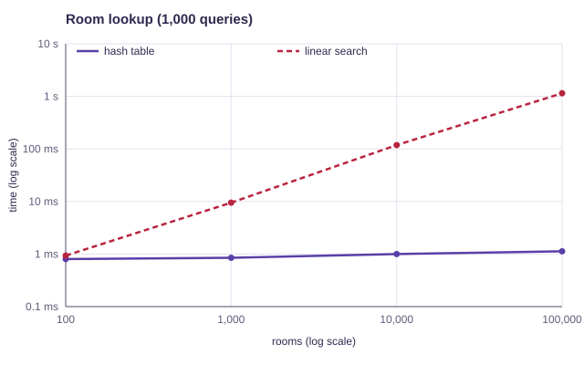
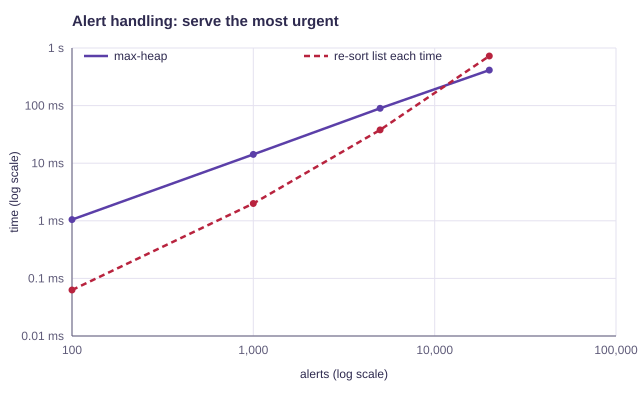
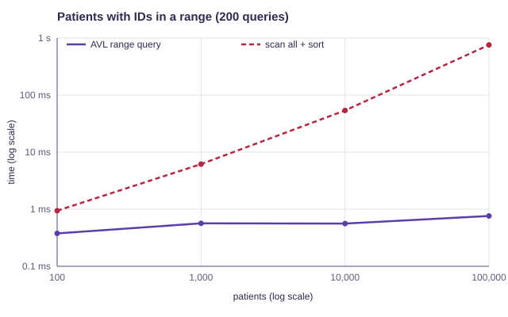
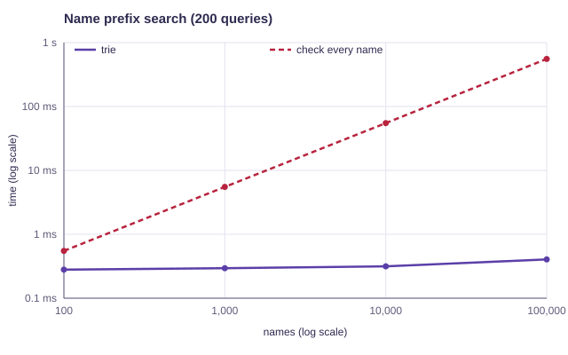
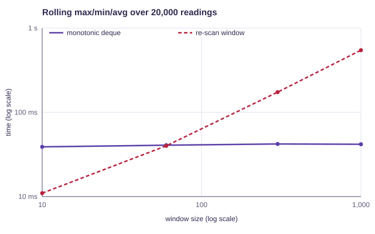
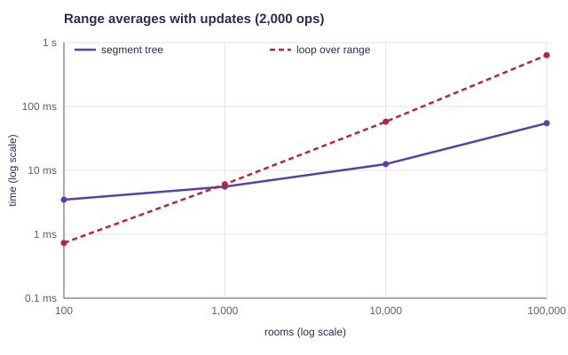
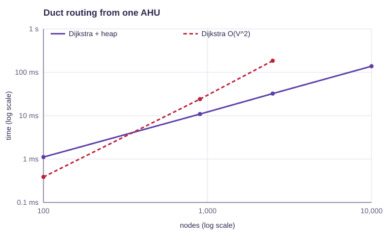
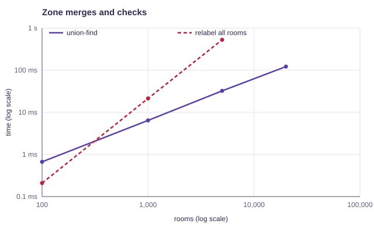
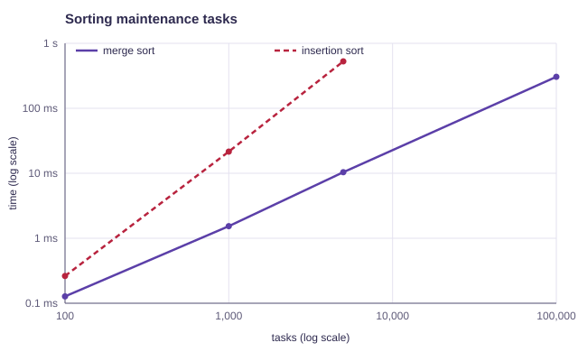
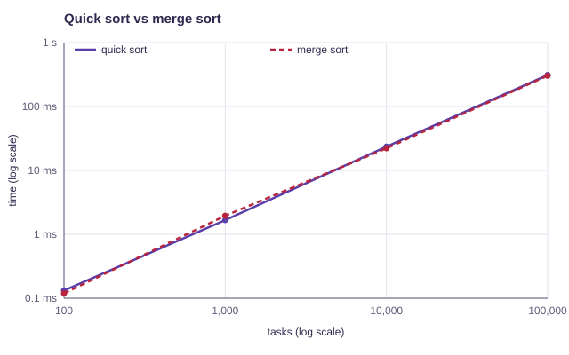

# Benchmark results

Generated by `python -m hospital_climate bench` on Windows-11, Python 3.14.10.
Each row is one run; both methods were checked to return the same answer.
Times depend on the machine: compare the growth, not the absolute numbers.

## Room lookup (1,000 queries)

| rooms | hash table | linear search | speed-up |
|---:|---:|---:|---:|
| 100 | 0.80 ms | 0.93 ms | 1.2x |
| 1,000 | 0.85 ms | 9.50 ms | 11.2x |
| 10,000 | 1.00 ms | 118.39 ms | 118.3x |
| 100,000 | 1.13 ms | 1.14 s | 1014.6x |

## Alert handling: serve the most urgent

| alerts | max-heap | re-sort list each time | speed-up |
|---:|---:|---:|---:|
| 100 | 1.05 ms | 0.06 ms | 0.1x |
| 1,000 | 14.24 ms | 2.00 ms | 0.1x |
| 5,000 | 89.90 ms | 37.92 ms | 0.4x |
| 20,000 | 413.06 ms | 725.93 ms | 1.8x |

## Patients with IDs in a range (200 queries)

| patients | AVL range query | scan all + sort | speed-up |
|---:|---:|---:|---:|
| 100 | 0.38 ms | 0.94 ms | 2.5x |
| 1,000 | 0.57 ms | 6.18 ms | 10.9x |
| 10,000 | 0.56 ms | 53.81 ms | 96.0x |
| 100,000 | 0.76 ms | 757.73 ms | 994.3x |

## Name prefix search (200 queries)

| names | trie | check every name | speed-up |
|---:|---:|---:|---:|
| 100 | 0.28 ms | 0.55 ms | 2.0x |
| 1,000 | 0.29 ms | 5.52 ms | 18.7x |
| 10,000 | 0.32 ms | 55.08 ms | 174.8x |
| 100,000 | 0.40 ms | 555.99 ms | 1373.8x |

## Rolling max/min/avg over 20,000 readings

| window size | monotonic deque | re-scan window | speed-up |
|---:|---:|---:|---:|
| 10 | 38.90 ms | 10.97 ms | 0.3x |
| 60 | 40.72 ms | 40.01 ms | 1.0x |
| 300 | 42.13 ms | 173.58 ms | 4.1x |
| 1,000 | 41.74 ms | 546.33 ms | 13.1x |

## Range averages with updates (2,000 ops)

| rooms | segment tree | loop over range | speed-up |
|---:|---:|---:|---:|
| 100 | 3.48 ms | 0.73 ms | 0.2x |
| 1,000 | 5.56 ms | 6.08 ms | 1.1x |
| 10,000 | 12.54 ms | 57.91 ms | 4.6x |
| 100,000 | 54.83 ms | 637.35 ms | 11.6x |

## Duct routing from one AHU

| nodes | Dijkstra + heap | Dijkstra O(V^2) | speed-up |
|---:|---:|---:|---:|
| 100 | 1.11 ms | 0.39 ms | 0.3x |
| 900 | 10.91 ms | 24.06 ms | 2.2x |
| 2,500 | 32.33 ms | 184.79 ms | 5.7x |
| 10,000 | 138.31 ms | skipped (too slow) |  |

## Zone merges and checks

| rooms | union-find | relabel all rooms | speed-up |
|---:|---:|---:|---:|
| 100 | 0.67 ms | 0.21 ms | 0.3x |
| 1,000 | 6.43 ms | 21.35 ms | 3.3x |
| 5,000 | 32.39 ms | 527.66 ms | 16.3x |
| 20,000 | 121.83 ms | skipped (too slow) |  |

## Sorting maintenance tasks

| tasks | merge sort | insertion sort | speed-up |
|---:|---:|---:|---:|
| 100 | 0.13 ms | 0.26 ms | 2.1x |
| 1,000 | 1.54 ms | 21.52 ms | 14.0x |
| 5,000 | 10.38 ms | 528.25 ms | 50.9x |
| 100,000 | 305.63 ms | skipped (too slow) |  |

## Quick sort vs merge sort

| tasks | quick sort | merge sort | speed-up |
|---:|---:|---:|---:|
| 100 | 0.13 ms | 0.12 ms | 0.9x |
| 1,000 | 1.67 ms | 1.95 ms | 1.2x |
| 10,000 | 23.57 ms | 22.20 ms | 0.9x |
| 100,000 | 311.18 ms | 303.38 ms | 1.0x |
